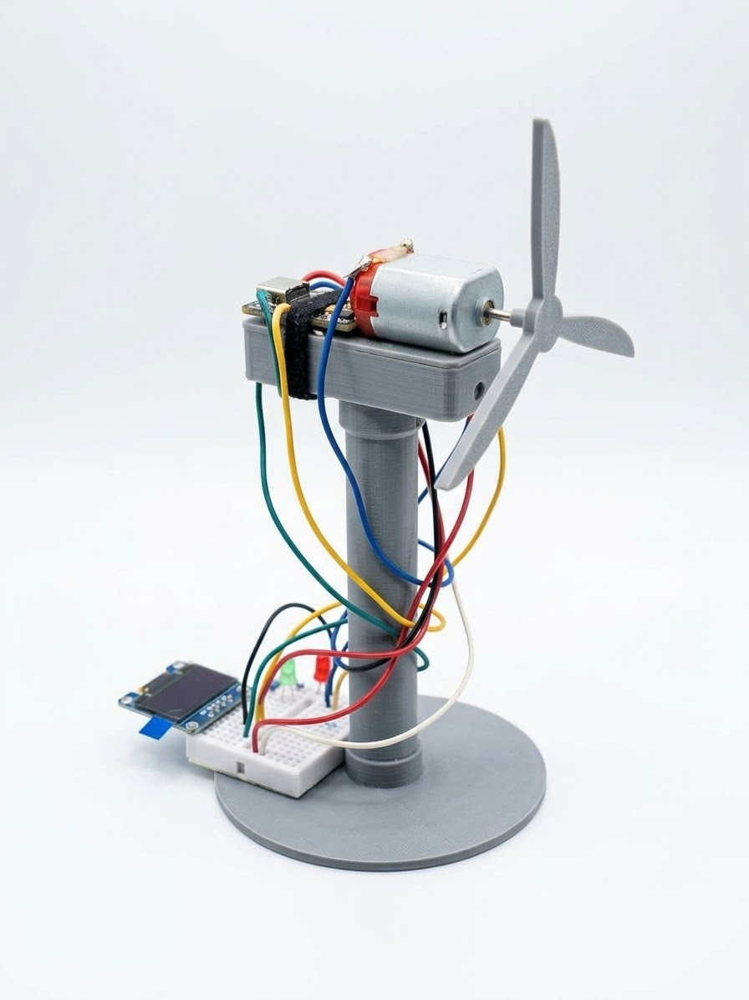
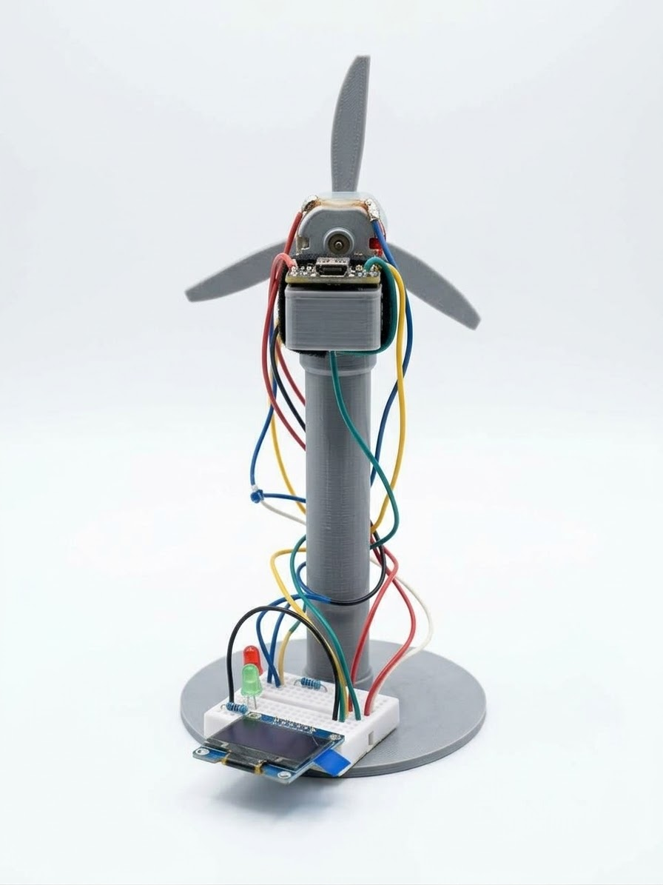

# Wind Turbine Monitor

A small prototype that watches the back-EMF of a motor-driven mini wind turbine and shows what the turbine is doing on an OLED screen and two LEDs. Built on an ESP32-C3 SuperMini.

The motor acts as a generator. The faster the blades spin, the higher the voltage it produces, so the voltage works as a stand-in for wind speed.

## Hardware

- ESP32-C3 SuperMini
- Small DC motor with blades (used as a generator)
- SSD1306 OLED, 128x64, I2C
- Green LED and red LED, each with a 220-330 ohm resistor
- Jumper wires

## Wiring

| Part | Connects to |
|---|---|
| Motor wire 1 | GPIO 0 |
| Motor wire 2 | GND |
| OLED SDA | GPIO 8 |
| OLED SCL | GPIO 9 |
| OLED VCC / GND | 3.3V / GND |
| Green LED (through resistor) | GPIO 4 |
| Red LED (through resistor) | GPIO 3 |

The motor connects straight to the ADC pin with no voltage divider, because it only produces around 100 mV at most. If the readings come out negative or stuck at zero when the blades turn in the wind, swap the two motor wires.

## How it works

The program measures the motor voltage, works out what state the turbine is in, and updates the LEDs and screen.

| State | Meaning | Green LED | Red LED |
|---|---|---|---|
| IDLE | Blades barely moving | off | off |
| RUNNING | Normal operation | on | off |
| WARNING | Spinning too fast | off | on |
| FAULT | Dangerously fast | off | on |

FAULT is latched. Once it triggers, it stays until you reset the board.

### Thresholds

Voltages are in millivolts. Each state has a lower "leave" value than its "enter" value, so the state doesn't flicker when the voltage sits right on a line (hysteresis).

| Change | Voltage |
|---|---|
| IDLE to RUNNING | 10 mV or more |
| RUNNING to IDLE | 5 mV or less |
| RUNNING to WARNING | 60 mV or more |
| WARNING to RUNNING | 45 mV or less |
| Any state to FAULT | 100 mV or more |

A state change only happens if the new state holds for 300 ms, so a single gust or noise spike doesn't trigger anything.

These numbers come from my own turbine (normal is about 20-30 mV, fast is about 80 mV). They are at the top of the code if you need to change them.

### Other details

- The ADC is set to its most sensitive range, since the signal is so small.
- Each reading is an average of 50 samples to reduce noise.
- At startup the program measures the "blades still" reading and subtracts it from everything after.
- Everything runs on `millis()` timers, with no `delay()` in the main loop.

## Setup

1. Install the Arduino IDE and add ESP32 board support.
2. Install the **U8g2** library from the Library Manager.
3. Select your board (for example "ESP32C3 Dev Module").
4. Set **Tools > USB CDC On Boot > Enabled**, otherwise the serial monitor stays empty.
5. Open `main.cpp` and upload it.
6. Keep the blades still when you power the board. The screen says "Keep blades still" for 3 seconds while it measures the zero point.

The serial monitor runs at 115200 baud and prints the voltage in mV.

## Files

- `main.cpp` - the main program
- `turbine_test.cpp` - a small test sketch that only prints voltage readings. Useful for checking your own motor and picking thresholds. Each sketch needs to be in its own folder with the same name as the file.
- `sim.py` - quick simulation (Includes LLM code)

## Limitations

- The ESP32 ADC can't read below 0 V, so it only sees the turbine spinning in one direction. Spinning the other way looks like IDLE.
- The ADC is least accurate near zero. It's fine for telling still, normal and fast apart, but not for precise measurements.
- The blades must be still at startup, or the zero offset will be wrong.
- There is no physical response yet (no braking), only LEDs and the display.

## Gallery

<table>
  <tr>
    <td align="center"> Main View</td>
    <td align="center"> Back View</td>
  </tr>
</table>

## Ideas for later

- Blinking patterns to tell WARNING and FAULT apart
- A buzzer
- A braking output (for example a MOSFET shorting the motor terminals)
- A second sensor or an external ADC for better accuracy
